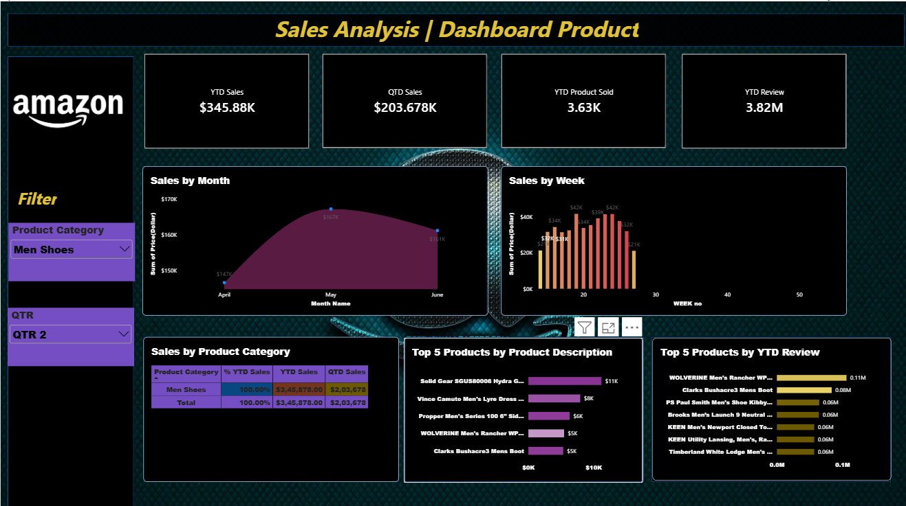

## 📊 Amazon Sales Analysis Dashboard | Power BI

## 📌 Project Overview

The **Amazon Sales Analysis Dashboard** is an interactive data visualization project developed using Microsoft Power BI. It provides insights into Amazon product sales, sales performance, product categories and customer reviews.

The dashboard helps users understand sales trends, monitor key performance indicators (KPIs) and identify top-performing products through interactive visualizations.

## 🎯 Project Objectives

- Analyze Year-to-Date (YTD) and Quarter-to-Date (QTD) sales performance.
- Track the number of products sold and customer reviews.
- Understand monthly and weekly sales trends.
- Analyze sales performance by product category.
- Identify the top 5 products based on sales and customer reviews.
- Provide interactive filters for better data exploration.

## 🛠️ Tools & Technologies

- **Microsoft Power BI** – Dashboard development and data visualization
- **Power Query** – Data transformation and preparation
- **DAX** – Measures and KPI calculations

## 📈 Dashboard Highlights

The dashboard includes the following key metrics and visualizations:

### 1. Key Performance Indicators (KPIs)
- YTD Sales: $345.88K
- QTD Sales: $203.678K
- YTD Products Sold: 3.63K
- YTD Reviews: 3.82M

### 2. Sales Trend Analysis
- Monthly sales analysis (April, May and June).
- Weekly sales performance analysis.

### 3. Product Category Analysis
- YTD sales by product category.
- QTD sales by product category.

### 4. Top 5 Product Analysis
- Top 5 products based on sales.
- Top 5 products based on YTD customer reviews.

### 5. Interactive Filters
- Product Category
- Quarter (QTR)

## 🖼️ Dashboard Preview

## 💡 Key Insights

- The dashboard displays YTD sales of $345.88K.
- May has the highest displayed monthly sales among April, May and June.
- Men's Shoes is the selected product category in the dashboard.
- Product-level analysis highlights the top products by sales and customer reviews.
- Interactive filters allow users to explore sales performance by category and quarter.

## 📁 Project Structure

Amazon-Sales-Analysis/
│
├── Amazon_Sales_Dashboard.pbix
├── Amazon_Dashboard.png
├── README.md
└── Dataset/
    └── sales_dataset.csv

*Note: Update the file names and dataset folder according to the files actually uploaded to your repository.*

## 🚀 Skills Demonstrated

- Data Analysis
- Data Visualization
- Power BI Dashboard Development
- KPI Tracking
- Business Intelligence
- Data Interpretation
- Interactive Reporting

## 👩‍💻 Author

**Tanvi Pote**

Aspiring Data Analyst

